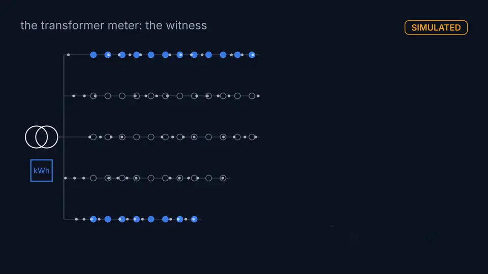

# SHAHID: did the customers lose power, or only their data?

SHAHID decides whether silent smart meters lost power or only stopped reporting, from the energy a meter
at their transformer still sees. IEEE TSYP14 EnergyMind Tunisia challenge, Phase 1 submission.
Paper: [SHAHID_Phase1_Proposal.pdf](SHAHID_Phase1_Proposal.pdf). Documents: [docs/README.md](docs/README.md).

[](docs/media/shahid_explainer.mp4)

Explainer (88 s, simulated data). The console walkthrough is shown in the demo video.

## What it does

When the meters under one MV/LV transformer go silent, their data cannot say why. An outage needs a crew;
a communication failure does not. A meter on the transformer's low-voltage side still counts the energy
of customers whose data stopped. SHAHID decides only when this evidence is clear, abstains otherwise, and
leaves every crew dispatch to a person.

## How it works

1. Silent group: meters that stop reporting together.
2. Expected energy M: the group's consumption predicted from each meter's history.
3. Unexplained energy R: the transformer reading minus the energy of the meters still reporting.
4. Two hypotheses: an outage predicts R near zero, a communication failure R near M, each with a spread
   fitted on fault-free days.
5. Decide or abstain: the likelihood ratio gives a probability. Inside a narrow band SHAHID abstains and
   sends the case to a person, with the evidence, an explanation and a hash-chained log entry.

Details: [docs/METHOD.md](docs/METHOD.md). What the system may do alone: [configs/escalation.yaml](configs/escalation.yaml).

## Results

Frozen method, each evaluation run once.

| Network | Coverage | Accuracy when deciding | False-outage rate | Missed-outage rate | Ledger |
|---|---|---|---|---|---|
| held-out urban (111 meters) | 0.723 | 0.995 | 0.000 | 0.009 | C7-01 |
| untouched rural (118 meters) | 0.494 | 1.000 | 0.000 | 0.000 | CP11-T2f |
| never used, rural (99 meters) | 0.6705 | 1.0 | 0.0 | 0.0093 | P2C-01, RPT-01 |
| never used, semi-urban (41 meters) | 0.5265 | 1.0 | 0.0 | 0.0 | P2C-01, RPT-01 |

Coverage is the share of events decided; the rest go to a person. Failures are measured the same way:
[docs/RESULTS.md](docs/RESULTS.md).

## Real vs. simulated

Every result is **SIMULATED** on public German benchmark networks (SimBench) with an AC power flow. There
is no utility data, no Tunisian data and no hardware, and nothing runs in real time.

Implemented: simulator, detector with abstention, baselines, explanations, hash-chained logs, escalation
table and a replay console ([ui/README.md](ui/README.md)) that no operator has used yet. Proposed: shared
learning beyond a proof of concept; the gate and re-check policies exist only in study code.

## Limitations

SHAHID needs **an energy meter at each transformer**; without one it cannot decide. It abstains on small
silent groups, misses more outages with hourly readings, and does not detect faults inside one meter.
Under its registered escalation table it sends many low-value items to a person. Read
[docs/LIMITATIONS.md](docs/LIMITATIONS.md) before any number.

## Quickstart

Python 3.11, fresh virtual environment; SimBench data ships inside the `simbench` package.

```
pip install -r requirements.lock streamlit==1.65.0
python -m pytest -q                   # every test
python -m shahid.check_numbers        # every document number against the claims ledger
python -m shahid.demo                 # outage, communication failure, abstention, one documented failure
streamlit run ui/app.py               # console replay of simulated days
```

Full reproduction: [docs/REPRODUCE.md](docs/REPRODUCE.md).

## Integrity

Each result in the documents and the paper traces to a [claims ledger](docs/CLAIMS_LEDGER.md) row (result
file, command, commit). Other numbers carry a reason in [docs/number_allowlist.yaml](docs/number_allowlist.yaml).
[check_numbers](shahid/check_numbers.py) and [check_tables](shahid/check_tables.py) check documents
against the ledger and the ledger against the result files.
Protocols were committed before their runs ([docs/process/protocols/](docs/process/protocols/),
[docs/eval_protocol.md](docs/eval_protocol.md)).

## Repository map

| Path | Content |
|---|---|
| `shahid/` | simulator, detector, baselines, explanations, evaluation, studies, checks |
| `configs/` | assumptions and parameters, including the escalation table and the business model |
| `dataset/` | simulated dataset, ODbL 1.0 ([dataset/README.md](dataset/README.md)), 24.6 MB tracked |
| `results/` | stamped result files ([results/README.md](results/README.md)) |
| `docs/` | method, results, claims ledger, limitations, studies, process records ([index](docs/README.md)) |
| `ui/`, `video/` | operator console ([ui/README.md](ui/README.md)); videos, rebuilt from source ([video/README.md](video/README.md)) |
| `tests/`, `notebooks/`, `proposal/` | tests, executed notebooks, paper source |

## Licences

Code: MIT ([LICENSE](LICENSE)). Dataset: ODbL 1.0, derived from the SimBench database
([dataset/LICENSE.md](dataset/LICENSE.md)). Reused packages: [docs/REUSE.md](docs/REUSE.md). Figures and
tables contain information from the SimBench database, made available under the ODbL 1.0.
