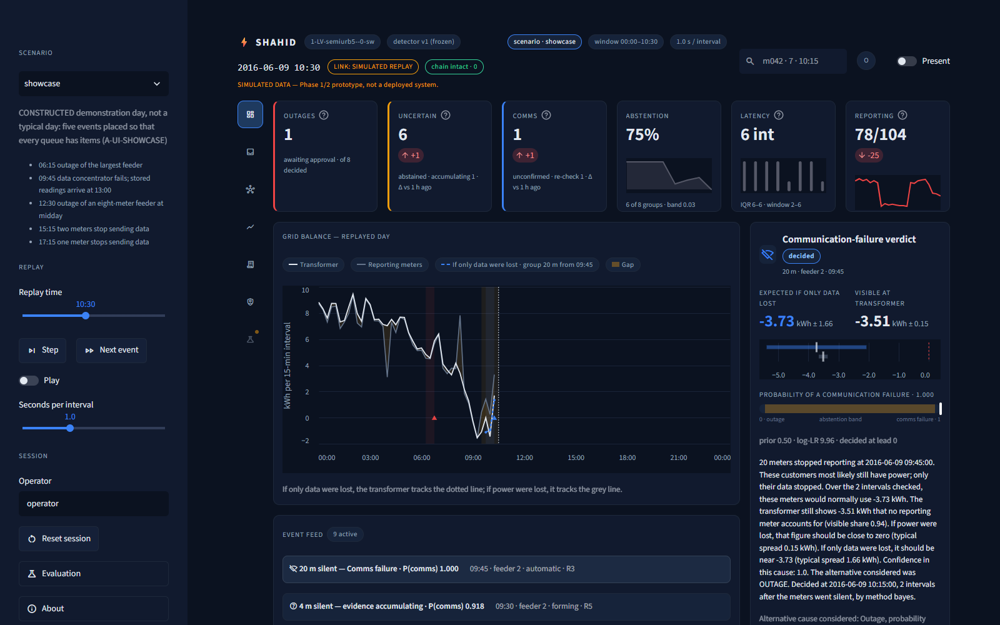
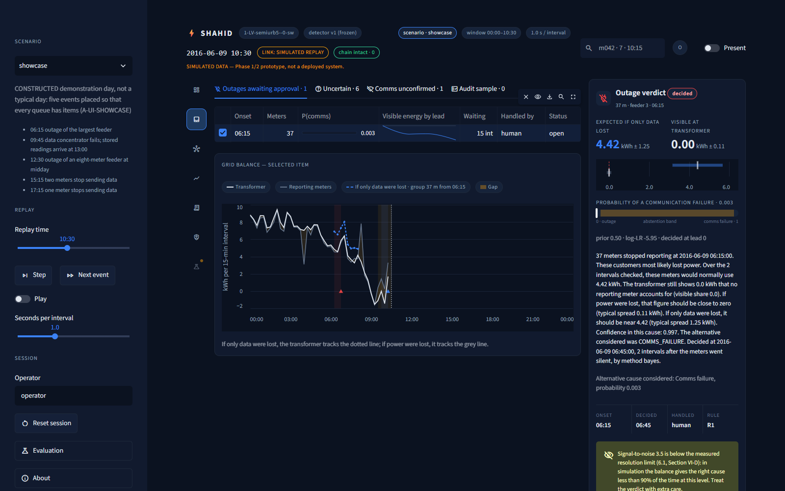

# SHAHID — when smart meters go silent: outage or lost data?

Extended report accompanying the submission paper `SHAHID_Phase1_Proposal.pdf` — IEEE TSYP14 EnergyMind Tunisia. All data SIMULATED.

[TOC]

## Executive summary

**Five verified contributions.**

1. **A safe diagnosis with honest coverage.** A transformer-side energy balance with abstention kept the
   false-outage rate at 0.00 on every evaluated grid: coverage 0.49–0.72 over three evaluations
   (CP12-T5), and 0.6705 and 0.5265 on two grids no earlier work had used (P2C-01, RPT-01).
2. **A declared operating envelope.** The resolution limit is measured (correct cause 0.90 of the time at
   an SNR of 6.1, CP10-T3), and so is the reporting interval: quarter-hour readings safe, hourly readings
   outside the envelope (missed 0.245, CAD-4).
3. **Governance by design.** An escalation table whose automatic action was measured, then made
   provisional (CP10-T0); a gate that escalates instead of closing, evaluated in study code and not wired into the escalation table (P2C-04);
   hash-chained decision and operator logs (C9-01); an operator console preview with trust devices.
4. **A failure mechanism measured and removed.** A powered meter merged into an outage group can supply
   the whole residual (EXP-01); it occurs 15.0 and 6.0 times per transformer-year on the unseen grids,
   and splitting silent groups by feeder removed every confident wrong verdict it caused, 4 to 0 (P2C-02).
5. **A verifiable evidence chain.** Protocols registered before every Phase 2 run, negative results
   reported, every number in a ledger checked by code, and a fresh-clone reproduction in which 177 of 178
   result files were identical (CP11-REPRO2).

**The question.** One low-voltage neighbourhood is fed by one MV/LV transformer, and its smart meters report every 15 minutes. When a group of meters goes silent, an operator must decide whether to send a repair crew (the customers lost power) or a data technician (only the messages stopped). Choosing wrong costs either a truck roll or a customer left in the dark.

**The method, in five lines.**

1. Meters that go silent at the same moment form one silent group.
2. Each meter's own fault-free history predicts how much energy the group would draw if it still had power.
3. The transformer's low-voltage meter shows how much energy is unaccounted for by the meters that still report.
4. A Student-t likelihood ratio compares the two explanations — power still flows, or power is lost — and turns them into a probability.
5. The system decides only when that probability is decisive; otherwise it abstains and hands the case to a person, with the evidence and a hash-chained record.

**Headline verified results.** The frozen version 1 detector was run once on two SimBench grids that no earlier work had touched (simulated test weeks):

| | rural2 (99 meters) | semiurb4 (41 meters) |
|---|---|---|
| Missed-outage rate | 0.0093 | 0.0 |
| False-outage rate | 0.0 | 0.0 |
| Accuracy when deciding | 1.0 | 1.0 |
| Coverage (share decided) | 0.6705 | 0.5265 |

Ledger P2C-01 and RPT-01. On the three earlier evaluations the same frozen detector decided 0.49–0.72 of the cases with a false-outage rate of 0.00–0.00 and a missed-outage rate of 0.00–0.01 (CP12-T5).

- **Operator load is a design variable.** The recommended policy, a meter-count gate that escalates instead of closing (evaluated in study code, not wired into `configs/escalation.yaml` or `explain.escalate`), cuts human items from 9.80 to 4.15 per transformer-day and false outage verdicts from 14.96 to 0.50 per transformer-year on rural2, with no outage closed silently among 350 whole-feeder outages (P2C-04).
- **One failure mechanism is measured and removed.** A powered meter that goes silent at the same moment as an outage can join the outage group and supply its residual. On the whole-feeder runs this happens 15.0 (rural2) and 6.0 (semiurb4) times per transformer-year (P2C-02). Splitting silent groups by feeder removed every confident wrong verdict it caused (4 to 0) without breaking a safety limit (P2C-02).

**Verified scope, in one sentence.** In simulation on five benchmark low-voltage grids, SHAHID separates power outages from communication failures for silent groups above its measured resolution limit, abstains below it, and records every decision in an auditable chain; every boundary of that statement is in the decision-boundary table (Section 8).


**Compliance summary** (full map in Section 10):

| Brief goal | Status |
|---|---|
| G1 monitor and detect | IMPLEMENTED + MEASURED for outage against communication failure; single-meter faults TESTED-NOT-DETECTED |
| G2 explain and record | IMPLEMENTED + MEASURED (probability, faithful explanation, hash-chained log); usefulness to people PROPOSED |
| G3 autonomy and oversight | IMPLEMENTED + MEASURED (escalation table, console preview); gate and re-check evaluated in study code, not wired; not validated with operators |
| G4 knowledge sharing | PROPOSED, with a measured proof of concept |

**About this document.** The submission paper is `SHAHID_Phase1_Proposal.pdf` (built from `proposal/`).
This extended report is the full engineering record behind it. There are no trained models by design: under the same safety limits, trained
classifiers missed more outages than the fitted method (CLF-02); the fitted probabilistic parameters
(`results/detector_params.json` and per-grid fits) are the models. The application files are the
operator console in `ui/`. In a bare clone installed from `requirements.lock`, the 14 console tests are
skipped; `pip install streamlit==1.65.0` enables them.

[NEWPAGE]

## How to read this report

- **Every number has a ledger row** in `docs/CLAIMS_LEDGER.md`, cited in brackets or by its identifier (for example C7-01). Each row names the result file, the command and the commit that produced it. `python -m shahid.check_numbers --doc docs/EXTENDED_REPORT.md` checks this report against the ledger.
- **Everything is SIMULATED** on German SimBench grids. Nothing comes from a utility.
- **Status words:** IMPLEMENTED (code exists), MEASURED (a stamped result exists), PROPOSED (designed, not built or not measured), REGISTERED (protocol committed before any run), TESTED-NOT-DETECTED (tested; the method does not detect it).
- **Development, held-out, confirmatory.** Development data choose settings. Held-out and confirmatory grids are evaluated once with frozen settings; their numbers are never used to change the method.

### Glossary of symbols

| Symbol | Meaning |
|---|---|
| R | energy the transformer shows that no reporting meter accounts for, over the decision window (kWh) |
| M | energy the silent group would draw if it still had power (kWh) |
| sd_O, sd_C | spread of R expected under an outage, and under a communication failure |
| P(comms) | posterior probability of a communication failure |
| b | abstention band: the system abstains while b < P(comms) < 1 − b |
| K, L | silence rule (readings missing before a group exists) and extra readings waited |
| coverage | share of labelled events that receive a verdict (1 − abstention rate) |
| missed-outage rate | outages called communication failure or never detected, over all outages |
| false-outage rate | communication failures called outage, over all communication failures |
| SNR | expected silent energy divided by its predictive spread |
| meter-day, transformer-year | exposure units for rates on fault-free data |

[NEWPAGE]

## Engineering method

The design was built with the engineering method: need, functions, specification, candidate solutions, a decision matrix filled with measured values, the decision, and its verification.

### The need (bête à cornes)

- **Whom does it serve?** Dispatch operators of the distribution utility, and the utility that answers for supply quality.
- **What does it act on?** Interval meter readings and the transformer's low-voltage energy series, as they arrive.
- **For what purpose?** To decide, transparently and without any control action, whether a silent group needs a repair crew or a data repair — and to say when it cannot tell.

### Functions and constraints (pieuvre)

| Code | Function or constraint |
|---|---|
| FP1 | Diagnose a silent group: outage, communication failure, or abstain |
| FP2 | Give a confidence, a plain-language explanation and an auditable record |
| FP3 | Escalate by rule: what the system may handle alone, what needs a person |
| FP4 | Share learning between sites without sharing personal data |
| FC1 | No labelled real data exists for this problem in Tunisia |
| FC2 | No control action on the grid |
| FC3 | Every reported number auditable |
| FC4 | Calibrate operator trust, against both over-trust and under-trust |
| FC5 | Interval consumption is personal data |
| FC6 | Reproducible from a fresh clone |
| FC7 | Modest compute |
| FC8 | Plausible utility integration: an export adapter, not a new platform |

### Functional specification (cahier des charges) with measured levels

| Function | Criterion | Level (measured or frozen) | Flexibility | Goal | Evidence |
|---|---|---|---|---|---|
| FP1 | missed-outage rate | ≤ 0.05; measured 0.0093 and 0.0 on unseen grids | none (safety) | G1 | P2C-01 |
| FP1 | false-outage rate | ≤ 0.05; measured 0.0 and 0.0 | none (safety) | G1 | P2C-01 |
| FP1 | fault-free false outages | ≤ 0.001 per meter-day; measured 0.0004 and 0.0006 | none (safety) | G1 | P2C-01 |
| FP1 | coverage | as high as the safety limits allow; 0.6705 and 0.5265 | free | G1 | RPT-01 |
| FP2 | explanation faithfulness | every number traces to the verdict record | none | G2 | `tests/test_explain.py` |
| FP2 | record integrity | hash chain verifies; one edit breaks it | none | G2 | C9-01 |
| FP3 | harm of automatic closure | measured, then made provisional | policy | G3 | CP10-T0 |
| FP4 | what leaves a site | fitted parameters only | design | G4 | P2D-10 |
| FC3 | document-to-ledger check | zero unmatched numbers | none | all | CHK-01 states its limits |
| FC6 | fresh-clone reproduction | 177 of 178 result files identical | low | all | CP11-REPRO2 |
| FC7 | compute | one power-flow step 15–20 ms on one core | free | all | C1-01 |

### Decision matrices (measured values only)

Ordering rule for every matrix: the safety criteria come first, in order (missed outages, false outages, fault-free false outages); then coverage; then compute. "Do nothing" is always a candidate: every silence goes to a person.

**M1 — Which detector.** Development validation, highest coverage that meets all safety limits (CP10-T5), then the held-out grid (AU-01):

| Candidate | Coverage at the limits (development) | Held-out coverage | Held-out false-outage rate | Held-out fault-free false outages per meter-day |
|---|---|---|---|---|
| Likelihood ratio with abstention (chosen) | 0.663 | 0.723 | 0 | 0.0010 |
| Two-sided z-test | 0.602 | — | — | — |
| Likelihood ratio without abstention | cannot meet the limits | 0.720 | 0.039 | 0.0038 |
| Visible-share test | cannot meet the limits | 0.720 | 0.045 | 0.0045 |
| Naive share baseline | cannot meet the limits | 0.871 | 0.065 | 0.0104 |
| Do nothing | every silence is a human item | — | — | — |

**M2 — A trained classifier instead?** Same safety limits, development validation (CLF-02): no full-feature classifier had a feasible band; missed outages 0.089 (logistic regression), 0.179–0.196 (gradient boosting), 0.232–0.250 (small neural network) against 0.036 for the fitted method. Decision: fitted probabilistic parameters, no trained classifier.

**M3 — Expected consumption.** The anchored estimator had the lowest validation error in every tested condition, for example 0.204 against 0.323 for the median at nominal diversity (C4-01); gradient boosting changed the error by −0.002 to +0.008 kWh per interval (C4-06). Decision: anchored estimator.

**M4 — Likelihood shape.** The fault-free gap residuals are skewed (0.71) and heavy-tailed (excess kurtosis 1.58) (C5-01). Decision: Student-t likelihoods rather than Gaussian.

**M5 — Threshold selection rule.** The first rule (balanced accuracy) called 419 of 1 051 fault-free silent groups outages (C5-03). The second (false-alarm budget only) missed outages at a rate of 0.366 (C5-04). The third (safety limits, then least abstention) chose the band 0.03 with missed outages 0.036 and abstention 0.337 (C5-05). The two failed rules are part of the justification: each shows which error an unconstrained rule buys.

**M6 — Escalation policy.** Confirmatory grid rural2 (P2C-04):

| Policy | Outages closed with no verdict | Human items per transformer-day | False outage verdicts per transformer-year |
|---|---|---|---|
| Version 1 table | 0 | 9.7992 | 14.959 |
| Gate that closes | 0 | 0.0109 | 0.4986 |
| Gate that escalates (recommended) | 0 | 4.1516 | 0.4986 |

On development, the closing gate lost 16 of 350 whole-feeder outages with no verdict; the escalating gate lost none (P2D-02). The escalating gate is the recommendation because it never closes an outage silently. It is evaluated in study code and is not yet wired into the escalation table.

**M7 — Split silent groups by feeder?** Safety met on both unseen grids, confident wrong comms verdicts on cross-feeder merges 4 to 0 (P2C-02); price on random-meter communication failures, abstention 0.4054 to 0.973 on rural2 (P2C-03). Decision: a configurable option for utilities whose concentrators follow the feeders.

**M8 — Evidence accounting version 2?** Not adopted: it missed more mid-interval outages than version 1 (0.2568 against 0.1174) (P2C-05).

### Master verification and validation plan

| Requirement | Means | Result | Status |
|---|---|---|---|
| FP1 separate outage from comms (G1) | frozen detector run once on unseen grids | missed 0.0093 and 0.0, false 0.0 and 0.0 (P2C-01) | VALIDATED WITH LIMITS (simulation) |
| FP1 abstain when undecidable | coverage and resolution limit | coverage 0.49–0.72 (CP12-T5); limit SNR 6.1 (CP10-T3) | VALIDATED WITH LIMITS |
| FP1 fault-free false outages | fault-free years | 0.0004 and 0.0006 per meter-day (P2C-01) | VALIDATED |
| FP2 confidence | reliability | extremes reliable (C7-05); mid range not calibrated over all groups (P2D-09) | VALIDATED WITH LIMITS |
| FP2 explanation faithfulness | unit test | every number from the record | VALIDATED |
| FP2 explanation usefulness | people study, protocol 07b | registered; results pending | PROPOSED |
| FP2 auditable record | hash-chain test and tamper test | verifies; edit detected (C9-01) | VALIDATED |
| FP3 escalation | policy evaluation | gate-escalate rows (P2C-04) | VALIDATED WITH LIMITS (not with operators) |
| FP3 operator interface | console preview, headless render tests | built; not used by operators | VALIDATED WITH LIMITS |
| FP4 shared learning | PoC, protocol 08 | negligible effect (P2D-10) | VALIDATED WITH LIMITS |
| G1 single-meter faults | protocols CP8 and 06 | not detected below gain × 0.5 (C8-01, P2C-06) | TESTED, NOT DETECTED |
| FC3 auditable numbers | number and table checkers | zero unmatched | VALIDATED (limits: CHK-01) |
| FC6 reproducibility | fresh clone | 177 of 178 identical (CP11-REPRO2) | VALIDATED |
| Deliverable: dataset and anomaly documentation | `dataset/`, `docs/anomaly_generation.md` | fault model check AU-05 | VALIDATED |
| Deliverable: trained models | fitted parameters | `results/detector_params.json` and per-grid fits | VALIDATED (by design) |
| Deliverable: demonstration video | runbook and script | to be recorded by the team | PROPOSED |

[NEWPAGE]

## The complete workflow

**Simulator and its four stores.** A pandapower power flow on SimBench low-voltage grids produces the hidden truth. Observation models add meter error, transmission loss, delay and concentrator failures. The simulator writes four separate stores: `truth/` (physical state), `observed/` (what a utility export could contain), `context/` (meters and network zones) and `labels/` (what really happened, written by the injector). The detector reads only `observed/` and `context/`; a test enforces it, and the fault model was checked layer by layer (AU-05).

**Detector, version 1 (frozen).** For each silent group: expected energy from each meter's anchored history; transformer residual against the reporting meters; Student-t likelihoods under the two causes; posterior with a 50/50 prior; decide at the first of up to five decision points where the posterior leaves the band 0.03, otherwise abstain. Parameters are fitted on fault-free history only.

**Detector, version 2 (registered alternative, not adopted).** A separate module (`shahid/detect_v2.py`) with four registered changes; with all changes switched off it reproduces version 1 exactly (test). It was evaluated once and not adopted (Section 7).

**Escalation and logs.** Each verdict passes through the escalation table (Section 5). Decision records and operator actions go into append-only, hash-chained logs that a single command verifies.

**Operator console (preview).** A Streamlit console replays stored simulated days through the frozen pipeline: three queues never merged, an evidence card per item, the network map, a hash-chained operator log, and trust instrumentation. It is a preview on replayed simulation, not a deployed system, and no operator has used it.





[NEWPAGE]

## Escalation logic

**Implementation status of the gate and the re-check.** The meter-count gate and the R3 re-check are evaluated in study code (`shahid/cp12.py`, `shahid/p2eval.py`). Neither is executed by `explain.escalate`. `configs/escalation.yaml` states the R3 re-check only as action text, and the console preview displays it as pending without acting on it. The gate is not in `configs/escalation.yaml`.

**Rules** (`configs/escalation.yaml`, first match wins). Only R3 is handled without a person, and its only action is to annotate the data and open a ticket; dispatching a crew always needs a human.

| Rule | When | Action | Handled by |
|---|---|---|---|
| R1 | outage verdict, 20 meters or more | alert at once; operator decides on dispatch | human |
| R2 | outage verdict, probability 0.95 or more | outage alert with the evidence; operator confirms | human |
| R3 | comms verdict, probability 0.95 or more, at most 40 meters | provisional data-quality ticket; re-check the backlog of readings | automatic, provisional |
| R4 | any other comms verdict | communications ticket, reviewed within the shift | human |
| R5 | abstention | review with the evidence | human |

**Measured harm of automatic closure.** As first written, rule R3 closed real outages without a person in 0.9% (held-out), 1.3% and 1.8% of cases nominally, rising to 24.1% under load-shaped unmetered energy of 10 kW (CP10-T0). R3 was therefore made provisional.

**Re-check trade-off.** A communication verdict is confirmed only if the stored readings arrive. The timeout sets the price: the share of genuine communication failures sent to a person for confirmation is 0.729, 0.523, 0.074 and 0.000 at 1, 2, 4 and 8 hours (CP12-T2b). Simulated failures last 1–4 hours, so the right timeout depends on real failure durations, which only a utility can supply.

**Gate that escalates (recommended; evaluated in study code, not wired).** Groups of one or two meters wait one hour; if their onset reading arrives, the case closes as data loss; otherwise it goes to a person. Figures in Section 3, matrix M6, and in Section 7.

**Over-trust and under-trust devices (implemented in the console preview).** Against over-trust: the alternative cause shown with every verdict, a random audit sample of automatic closures, and approvals given within seconds flagged. Against under-trust: a track record per verdict class and overrides recorded with their outcome. The console labels the mid-range probability as "current evidence strength, not validated accuracy", because mid-range probabilities are not calibrated over all silent groups (P2D-09).

**What was validated with people, and what was not.** No operator has used the console and no person outside the team has read the explanations. The people study (protocol 07b) is REGISTERED with its pack in `docs/process/people_study/`; RESULTS PENDING.

[NEWPAGE]

## Collective defence

**What is shared, what stays local, and why.**

| Item | Where | Why |
|---|---|---|
| Fitted shape parameters of the noise model | shared | dimensionless, carry no readings |
| Gap scale and baseline | local | site-specific |
| Meter readings, customer and meter identifiers | local | personal data (FC5) |
| Network topology | local | utility asset data |
| Anonymous failure signatures | shared | PROPOSED, not built |
| Operator-confirmed outcomes without identifiers | shared | PROPOSED, not built |
| Upstream coordinator for rotating cuts | coordinator | PROPOSED, not built |

**What the proof of concept measured** (protocol 08, P2D-10). A new site that receives another site's shape parameters gains almost nothing: with one day of its own data, coverage of the nominal central interval was 0.978 when fitted locally and 0.96 with shared parameters, against 0.964 for a full-year local fit; no condition reached the usable band, and shared parameters gave more fault-free outage verdicts (9 against 4). **Design insight:** local calibration is fast, so collective defence should not rest on sharing noise parameters. It rests on what did transfer — frozen thresholds that kept the false-outage rate at 0.0 on unseen grids (P2C-01) — and, as PROPOSED next steps, on anonymous failure signatures and operator-confirmed outcomes.

[NEWPAGE]

## Results by protocol

### Phase 1, frozen version 1

- Development validation: abstention 0.337, missed outages 0.036, false outages 0, fault-free 0.0006 per meter-day (C5-05).
- Held-out grid urban6, run once: coverage 0.723, missed 0.009, false 0, accuracy when deciding 0.995 (C7-01, AU-01).
- Untouched grid rural3, run once: coverage 0.494, missed 0.000, false 0.000 (CP11-T2f).
- Resolution limit: correct cause 0.90 of the time at an SNR of 6.1 (CP10-T3).
- Operator load: 10.23 human items per transformer-day on development, almost all from 1–2-meter silences (CP10-T1); 32.1–40.1 fault-free false outage verdicts per transformer-year, a base-rate effect of tiny groups (CP10-T2).
- Reporting interval (post-hoc study): quarter-hour readings safe; half-hour inconclusive, missed outages 0.036 with an upper bound of 0.0518 (RPT-02); hourly readings outside the envelope, missed 0.245 (CAD-4).

### Phase 2, protocols registered before any run

| Protocol | Registered hypothesis | Verdict | Evidence |
|---|---|---|---|
| 01 size-dependent prior | fewer false outages without breaking safety | not supported: missed outages 0.1071–0.3214, above the 0.05 limit; recommend version 1 | P2D-01 |
| 01 gate that escalates | no outage closed silently | holds; on unseen grids it adds load (4.1516 against 0.0109 per transformer-day) | P2D-02, P2C-04 |
| 02 evidence version 2 | fewer false outages at 60 min (S1); fewer missed mid-interval outages (S2) | S1 not supported (interval −0.0173 to 0.0012); S2 not supported, worse (0.2568 against 0.1174) | P2D-06, P2D-07, P2C-05 |
| 03 split by feeder | removes confident wrong merge verdicts (H5a), safe (H5b) | supported (4 to 0), safe on both grids; price measured | P2D-04, P2D-05, P2C-02, P2C-03 |
| 04 prior after the split | as protocol 01 | not feasible (missed at least 0.1071) | P2D-03 |
| 06 single-meter faults | detection at least 0.5 at 1% false alarms (H3) | not supported (gain × 0.5: 0.3467) | P2D-08, P2C-06 |
| 07a reliability | mid-range calibration (H7) | not supported over all groups (calibration error 0.494) | P2D-09 |
| 07b people study | explanations understood alone | REGISTERED, RESULTS PENDING | `docs/process/people_study/` |
| 08 shared learning | sharing speeds up calibration (H8) | supported by its criterion, negligible in practice | P2D-10 |
| 10 literature | verified references only | ten references fetched and quoted | `docs/literature/` |

[NEWPAGE]

## Decision-boundary table

Every boundary of the verified scope, numbered; former LIMITATIONS items keep their numbers (B1–B28). Status: DONE (the remedy is in place), REGISTERED (protocol committed, with date), DEFERRED (with reason).

| # | Decision or boundary | Engineering reason | Measured evidence | Consequence for use | Remedy and status |
|---|---|---|---|---|---|
| B1 | All data is simulated | FC1: no labelled field data exists for this problem in Tunisia | the whole ledger | numbers describe the bench, not a utility | first field step: a retrospective test on one substation — DEFERRED (needs utility data) |
| B2 | Simulator and detector written by the same team | FC1 | held-out and confirmatory grids (C7-01, P2C-01) | regularities of our simulator may help the detector | separated stores, leak test (AU-05) — DONE; field test — DEFERRED |
| B3 | Energy conserved by construction | physics of the benchmark | balance closes to 6e-8 MW (C1-05) | real imbalance, clock drift and losses are absent | DEFERRED (field data) |
| B4 | German benchmark profiles | no Tunisian profiles available | SimBench | consumption and PV are not Tunisian | DEFERRED; profiles are never reshaped to look Tunisian |
| B5 | Uncalibrated customer diversity | SimBench customers are scaled copies (C1-06) | coverage 0.484–0.663 over the range (CP10-T7) | results are reported over the range | calibration on household data — DEFERRED (licence) |
| B6 | Transformer metering unverified in Tunisia | the enabling assumption | gain sd 2%: missed 0.046 (C6-04) | a prerequisite of deployment | utility confirmation — DEFERRED |
| B7 | Offline, not real time | scope fence | decision timing emulated from arrival stamps | no latency claim beyond simulation | DEFERRED |
| B8 | Meter and comms parameters are assumptions | no standard or utility values | `docs/ASSUMPTIONS.md` | rates depend on them | DEFERRED (field data) |
| B9 | Escalation table not validated with operators | no operators available | — | policy is a configurable design | people study REGISTERED 2026-10-14 |
| B10 | Groups formed by common onset | silence is the only shared signal | simultaneous outage and comms: missed 0.373 (C6-06) | merged events are a known blind spot | split by feeder (protocol 03) — DONE as an option |
| B11 | Small groups often undecidable | energy below the noise | resolution limit SNR 6.1 (CP10-T3) | abstention, not a wrong verdict | DONE by design (abstention) |
| B12 | Confident wrong comms verdicts possible | merged or delayed powered meter | smoke demo 0.996 (C9-01); held-out missed 0.009 (C7-01) | R3 made provisional | DONE (provisional R3; split option) |
| B13 | Load-shaped unmetered energy | breaks the balance assumption | missed 0.122 at 5 kW, 0.241 at 10 kW (C6-05) | needs a load-dependent gap model | DEFERRED (Phase 2 plan priority 4) |
| B14 | Single-meter faults | the balance localises to a group, not a meter | at most 20% detected (C8-01) | goal G1 partly covered | dedicated test, see B33 |
| B15 | One held-out grid in Phase 1 | grid supply | — | — | DONE: two further unseen grids (P2C-01) |
| B16 | Rule R3 unsafe as first written | automatic closure of outages | 24.1% under 10 kW load-shaped energy (CP10-T0) | — | DONE: provisional R3; re-check evaluated in study code, not executed at run time |
| B17 | Goal G1 partly covered | as B14 | C8-01, P2C-06 | — | see B33 |
| B18 | Grid size class | grid supply | now also a 41-meter grid (P2C-01) | larger networks untested | partly DONE |
| B19 | One simulated world per grid | compute | worlds 0–3: abstention 0.397–0.401 (CP10-T10) | small spread | DONE (spread reported) |
| B20 | Operator load from ordinary data loss | tiny random-loss groups | 10.23 items per transformer-day (CP10-T1) | needs a policy | gate that escalates — DONE as option (P2C-04) |
| B21 | Fitted statistics, no trained classifier | measured (M2) | CLF-02 | "AI" means automated statistical decision | DONE by design |
| B22 | Closing gate can lose small outages | gate design | 16 of 350 lost on development (P2D-02) | — | escalating gate evaluated (study code), not wired |
| B23 | Re-check judged on simulated durations | no field durations | 0.729 to 0.000 over 1–8 h (CP12-T2b) | timeout is a utility choice | DEFERRED (field durations) |
| B24 | False outage verdicts on tiny groups | base rate under a 50/50 prior | 32.1–40.1 per transformer-year (CP10-T2) | handled by policy | prior tested and rejected (B30); gate — DONE |
| B25 | Number checker weak for two-decimal rates | tolerance | CHK-01 | generated documents are the real protection | DONE (stated) |
| B26 | Console is a preview on replayed simulation | scope | decisions 0006, 0007 | not a deployed system | DEFERRED (operator trials) |
| B27 | Powered meter merged into an outage group | common-onset grouping | posterior 0.9992 wrong (EXP-01); 15.0 merges per transformer-year (P2C-02) | split option removes the confident wrong ones | DONE as option (P2C-02) |
| B28 | pandas warning in the replay engine | library change | committed replays unaffected | none today | DEFERRED (keep results tied to their code) |
| B29 | Size-dependent prior rejected | safety first | missed 0.1071–0.3214 (P2D-01) | version 1's 50/50 prior stays | DONE (registered negative) |
| B30 | Split by feeder has a price | scattered comms failures split | abstention 0.4054 to 0.973 (P2C-03) | only for feeder-aligned concentrators | DONE (configurable) |
| B31 | Evidence version 2 not adopted | silence of one reading at coarse intervals | missed 0.2568 against 0.1174 (P2C-05) | quarter-hour readings are a deployment prerequisite | variant with two-reading silence — DEFERRED |
| B32 | Hourly readings outside the envelope | short events unobservable | missed 0.245 (CAD-4) | deployment needs quarter-hour data | DONE (envelope declared) |
| B33 | Single-meter faults under the stiff benchmark upstream | own-load voltage signal far below noise | gain × 0.5 detected 0.3467 (P2C-06) | not detected below large errors | DEFERRED (field voltage data) |
| B34 | Mid-range probabilities | 50/50 prior against a high base rate of data loss | calibration error 0.494 (P2D-09) | labelled as evidence strength in the console | DONE (labelling) |
| B35 | Shared learning negligible | local calibration is fast | P2D-10 | design rests on transferred thresholds | DONE (design changed) |
| B36 | Explanations not tested with people | no participants yet | — | usefulness unknown | REGISTERED 2026-10-14 (protocol 07b) |

[NEWPAGE]

## Verified scope and commitments

**What SHAHID commits to.**

- It separates power outages from communication failures in simulation, for silent groups above its measured resolution limit, with the false-outage rate at 0.0 on every evaluated grid (CP12-T5, P2C-01).
- It abstains when the evidence is weak, and says so; coverage is always reported next to accuracy.
- It quantifies its own boundaries: resolution limit, reporting interval, unmetered energy, transformer-meter error, merges.
- Every verdict carries its evidence, its probability, the alternative cause and a tamper-evident record.
- Operator load is a configurable design variable with measured consequences (P2C-04).

**What it does not commit to, and why.**

| Not committed | Engineering reason |
|---|---|
| Performance on Tunisian networks | no Tunisian data was used (FC1) |
| Real-time or deployed operation | offline, on replayed simulation |
| Detection of faults inside a single meter | measured and not detected (B33) |
| Operation with hourly readings | outside the measured envelope (B32) |
| Reduced workload for version 1 as such | load depends on policy; the gate is a separate choice, evaluated in study code and not wired |
| Novelty | literature positions SHAHID by comparison only (Section 12) |
| Operator acceptance | not yet tested with people (B36) |

[NEWPAGE]

## Compliance map

| Brief item | Section | Status |
|---|---|---|
| G1 monitor smart-meter readings | 4 | IMPLEMENTED + MEASURED |
| G1 monitor voltage | 7 (protocol 06) | TESTED-NOT-DETECTED |
| G1 monitor current and power quality | 9 | PROPOSED (not in 15-minute data) |
| G1 detect equipment faults and natural failures | 7 | IMPLEMENTED + MEASURED (as loss of supply) |
| G1 detect degraded or biased sensors | 7, B33 | TESTED-NOT-DETECTED |
| G1 detect corrupted readings | 4, 7 | IMPLEMENTED + MEASURED (missing and delayed) |
| G1 detect falsified readings | 7 (protocol 06) | TESTED-NOT-DETECTED (large errors only) |
| G1 genuine event against data-quality problem | 1, 7 | IMPLEMENTED + MEASURED |
| G2 confidence score | 5, 7 | IMPLEMENTED + MEASURED |
| G2 plain-language explanation | 4 | IMPLEMENTED + MEASURED (faithfulness); usefulness PROPOSED |
| G2 auditable log | 4 | IMPLEMENTED + MEASURED |
| G2 interpretable approach | 3 (M2) | IMPLEMENTED + MEASURED |
| G3 thresholds for automatic actions | 5 | IMPLEMENTED + MEASURED |
| G3 situations needing human approval | 5 | IMPLEMENTED + MEASURED |
| G3 operator interface | 4, 5 | IMPLEMENTED (preview, not validated with people) |
| G3 over-trust and under-trust | 5 | IMPLEMENTED (devices); validation PROPOSED |
| G4 sharing design | 6 | PROPOSED, with a measured proof of concept |
| G4 shared, local and why | 6 | IMPLEMENTED (table) |
| G4 single-node prototype | 4 | IMPLEMENTED + MEASURED |
| Dataset and injected anomalies | 4 | IMPLEMENTED + MEASURED |
| Documentation of anomaly generation | 11 | IMPLEMENTED (`docs/anomaly_generation.md`) |
| Privacy: what leaves a site | 6 | IMPLEMENTED (design); parameters only |
| Deliverable: complete workflow | 4 | IMPLEMENTED |
| Deliverable: escalation logic | 5 | IMPLEMENTED + MEASURED |
| Deliverable: collective-defence design | 6 | PROPOSED, with a measured proof of concept |
| Deliverable: trained models | 3 (M2), README | IMPLEMENTED (fitted parameters, by design) |
| Deliverable: application files | `ui/` | IMPLEMENTED |
| Deliverable: video and presentation | — | PROPOSED (to be recorded) |

[NEWPAGE]

## Verification guide

A reviewer can check the main claims in about half an hour:

```
pip install -r requirements.lock
python -m pytest -q                       # all tests pass, including the leak test
python -m shahid.demo                     # demo on the committed dataset
python -m shahid.check_numbers            # documents against the ledger: 0 unmatched
python -m shahid.check_numbers --doc docs/EXTENDED_REPORT.md
python -m shahid.check_tables             # paper tables: 0 unmatched
python -m shahid.verify_repro             # quick fresh-clone reproduction check
python -m shahid.build_report             # optional PDF of this report in docs/build/ (not tracked)
streamlit run ui/app.py                   # console preview (pip install streamlit==1.65.0)
```

- **Claims ledger.** `docs/CLAIMS_LEDGER.md`: every reported number with its result file, command, commit and configuration hash. Retracted claims are listed at its end.
- **Protocols and findings.** `docs/process/protocols/` (registered before any run, with dated addenda) and `docs/process/findings/`.
- **Licences.** Code MIT (`LICENSE`); the simulated dataset ODbL 1.0, derived from SimBench, which is ODbL 1.0; figures and tables contain information from the SimBench database, made available under the ODbL 1.0; reused packages in `docs/REUSE.md`.

[NEWPAGE]

## References

Verified sources only; each was fetched and quoted on the access date given (`docs/literature/REFERENCES.md`).

1. R. Sevlian, Y. Zhao, A. Goldsmith, R. Rajagopal, H. V. Poor, "Distribution System Outage Detection using Consumer Load and Line Flow Measurements", arXiv:1503.08244. Accessed 14 October 2026.
2. A. Gandluru, S. Poudel, A. Dubey, "Joint Estimation of Operational Topology and Outages for Unbalanced Power Distribution Systems", arXiv:1912.04543. Accessed 14 October 2026.
3. Y. Wang, Q. Chen, T. Hong, C. Kang, "Review of Smart Meter Data Analytics: Applications, Methodologies, and Challenges", arXiv:1802.04117; IEEE Transactions on Smart Grid. Accessed 14 October 2026.
4. X. Wang, Z. Shi, B. Liu, W. Xiao, S. Cheng, "Smart meter-based outage detection method for power distribution systems", EAI Endorsed Transactions on Energy Web, doi:10.4108/ew.5767. Accessed 14 October 2026.
5. U.S. Department of Energy, "Advanced Metering Infrastructure and Customer Systems: Results from the Smart Grid Investment Grant Program". Accessed 14 October 2026.
6. C. Huang et al., "Smart Meter Pinging and Reading Through AMI Two-Way Communication Networks to Monitor Grid Edge Devices and DERs", OSTI 1860827. Accessed 14 October 2026.
7. C.-K. Chow, "On optimum recognition error and reject tradeoff", IEEE Transactions on Information Theory, doi:10.1109/TIT.1970.1054406. Accessed 14 October 2026.
8. R. El-Yaniv, Y. Wiener, "On the Foundations of Noise-free Selective Classification", Journal of Machine Learning Research. Accessed 14 October 2026.
9. Y. Geifman, R. El-Yaniv, "Selective Classification for Deep Neural Networks", arXiv:1705.08500. Accessed 14 October 2026.
10. V. Franc, D. Prusa, V. Voracek, "Optimal Strategies for Reject Option Classifiers", Journal of Machine Learning Research. Accessed 14 October 2026.
11. S. Meinecke et al., "SimBench — A Benchmark Dataset of Electric Power Systems to Compare Innovative Solutions Based on Power Flow Analysis", Energies, doi:10.3390/en13123290 (data source, ODbL 1.0).
12. L. Thurner et al., "pandapower — An Open-Source Python Tool for Convenient Modeling, Analysis, and Optimization of Electric Power Systems", IEEE Transactions on Power Systems, doi:10.1109/TPWRS.2018.2829021 (software).
